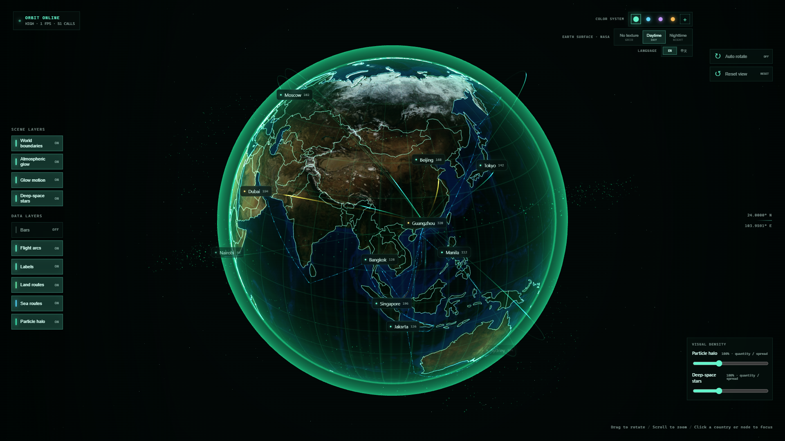
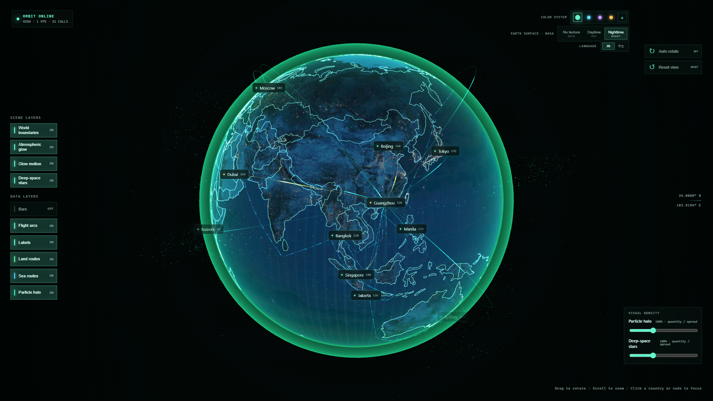
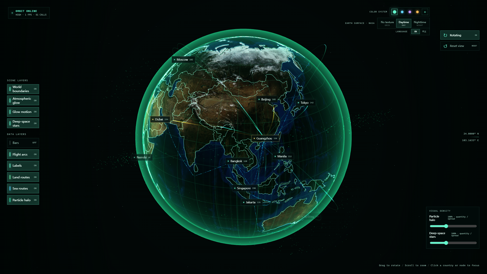

<div align="center">

# Orbitalis

### Give your data a world to move through.

**An interactive Three.js globe for digital twins, data visualization, and large-screen dashboards.**

Vue 3 + Vite · React 19 + Vite + TypeScript

*瑠璃色の地球 — a lapis-blue Earth.*

[](globe-3d-map-vue/)
[](globe-3d-map-react/)
[](https://threejs.org/)
[](LICENSE)
[](https://github.com/Xie-Fantasy/Orbitalis/actions/workflows/ci.yml)

[English](README.md) · [简体中文](README.zh-CN.md) · [Quick start](#quick-start) · [Integration guide](docs/INTEGRATION.md) · [Contribute](CONTRIBUTING.md)



</div>

## From coordinates to a living global scene

A list of locations tells you **where**. Orbitalis helps you show **how they connect**.

Build the global view of a digital twin, a logistics control room, an operations dashboard, or an exhibition display. Put your nodes on the globe, connect them with animated routes, and let viewers explore the network through smooth camera motion and geographic selection.

Orbitalis brings the visual foundation together: Earth imagery, atmospheric glow, flight arcs, land and sea routes, geographic labels, bars, starfields, and a particle halo. Choose the Vue or React implementation to match your application.

**This repository ships two runnable source projects with reusable globe layers and controllers.** It is currently a source-level integration starting point, rather than a published npm package or a complete digital-twin backend. Connect your own business data and application UI.

## See it in action

These are real 1920 × 1080 browser screenshots captured from the included applications, using the bundled demo data.

| React · daytime | React · nighttime |
| :---: | :---: |
|  |  |



Earth imagery: NASA. Screenshots show illustrative routes and synthetic metrics.

## What makes Orbitalis useful

- **Two frameworks, a familiar scene architecture.** A Vue 3 implementation and a React 19 implementation with a TypeScript globe core. Pick the stack your team already uses.
- **Layers that tell a story.** Combine nodes, labels, bars, flight arcs, land routes, and sea routes; toggle layers to emphasize the information that matters.
- **A globe that follows your attention.** Damped zoom includes a subtle orbital movement toward the surface under your pointer. Click a country or node to focus, and use Escape to clear selection.
- **Routes with geographic context.** Great-circle flight arcs and a sea-route planner using a local land mask. Sea paths are visual approximations, not navigation instructions.
- **A look that fits your dashboard.** Four color themes, a custom accent, daytime/nighttime/grid surfaces, and adjustable starfield and particle density.
- **Local assets, no map API key.** Earth textures and geographic data are bundled locally; the included scene needs no paid map service or imagery CDN at runtime.
- **A core you can inspect and extend.** Separate scene orchestration, layers, camera control, data validation, geography utilities, resource cleanup, and runtime diagnostics.

## Built for

| Scenario | Start with |
| --- | --- |
| Digital-twin global overview | Sites, hubs, facilities, and connections between them |
| Logistics and supply-chain displays | Flight arcs, land routes, sea routes, port and hub nodes |
| IoT and operations dashboards | Device/site locations and geographically distributed metrics |
| Large-screen visualization / 数据可视化大屏 | Atmospheric presentation, themes, labels, and controlled camera motion |
| Portfolios and exhibition screens | A visual globe scene you can customize in source |

## Choose your version

| | Vue | React |
| --- | --- | --- |
| Directory | [`globe-3d-map-vue`](globe-3d-map-vue/) | [`globe-3d-map-react`](globe-3d-map-react/) |
| UI | Vue 3 single-file components | React 19 components and hooks |
| Globe core | Primarily JavaScript; TS in UI/configuration | TypeScript |
| Build tool | Vite | Vite |
| Tests | Node test runner | Vitest |
| Where to start | `src/views/globe/GlobeView.vue` | `src/app/GlobePage.tsx` |

Both versions contain the globe, route layers, themes, local Earth textures, node interactions, and language controls. They are separate implementations, with some differences in UI and error-state presentation; they do not share a runtime package. The interface provides English and Chinese controls, with English selected initially.

## Quick start

Use **Node.js 22.12+** and npm, plus a browser with WebGL enabled. No API key is required.

```bash
git clone https://github.com/Xie-Fantasy/Orbitalis.git
cd Orbitalis
```

### React + TypeScript

```bash
cd globe-3d-map-react
npm ci
npm run dev
```

### Vue

In a separate terminal, from the repository root:

```bash
cd globe-3d-map-vue
npm ci
npm run dev
```

Open the local URL printed by Vite. Each version owns its own `package.json` and lockfile; run commands inside the version you selected. There is no root npm workspace.

### Production build

Inside either version:

```bash
npm run build
npm run preview
```

Build output is written to that version's `dist/`. For a subdirectory deployment, configure Vite's `base` to match the hosting path. The Vue implementation also includes `/three-3d-globe`; configure an SPA fallback when hosting that route.

## Make it yours

1. Replace the demo records in `src/globe/data/locations`, `flightRoutes`, and `transportRoutes` (`.js` in Vue, `.ts` in React).
2. Adjust themes and camera defaults in `src/globe/config/`.
3. Compose your dashboard around the page component, or mount `GlobeWorld` inside your own container.
4. Add your data-source adapter and business panels as needed.

Coordinates use **`[longitude, latitude]` in degrees**. Every location and route needs a stable `id`; route endpoints reference location IDs.

The [integration guide](docs/INTEGRATION.md) includes a typed React example, data contracts, layer controls, and cleanup requirements. Runtime data changes currently require application-side integration; do not assume a streaming or incremental-update API.

## Controls

| Action | Control |
| --- | --- |
| Rotate | Drag the globe |
| Zoom | Mouse wheel, with damped distance and pointer-directed orbital motion |
| Inspect a node | Hover or click |
| Focus a country | Click its surface |
| Clear focus | Escape or click the selected node/country again |
| Change the scene | Layer, color, texture, rotation, and density controls |
| Change language | `LANGUAGE` → EN / 中文 |

## Development

Run in the selected implementation:

```bash
npm test
npm run typecheck
npm run build
```

React also provides `npm run lint`. The [CI workflow](.github/workflows/ci.yml) checks both implementations independently.

As of the initial publication checks: Vue passed 35 unit tests; React passed 23. These cover geography, validation, routing, and (in Vue) lifecycle/state utilities. They are not a claim of full browser or production certification. Rendering performance depends on hardware, resolution, and layer/data density.

## Scope and roadmap

The current release provides a globe visualization foundation. Demo values are synthetic; land and sea routes are illustrative. Country outlines use low-resolution Natural Earth data, intended for a global overview rather than authoritative boundaries or surveying. There is no built-in real-time telemetry backend, building-level twin, terrain engine, or navigation service.

Ideas for future contributions:

- [ ] A packaged component API and npm distribution
- [ ] Data adapters and incremental scene updates
- [ ] Timeline playback and moving objects
- [ ] Label clustering and larger-dataset benchmarks
- [ ] Closer parity between Vue and React UI states

These are roadmap ideas, not current features. Suggestions and focused pull requests are welcome.

## Contribute and share

Building a globe for a digital-twin project, logistics screen, or visualization dashboard? Tell us what you are making in [Issues](https://github.com/Xie-Fantasy/Orbitalis/issues). Screenshots, reproducible bug reports, integration examples, and performance measurements are especially useful.

Read [CONTRIBUTING.md](CONTRIBUTING.md) before opening a pull request. If Orbitalis saves you time, a star helps other visualization developers discover it.

## License and credits

Project code is available under the [MIT License](LICENSE). Third-party assets and dependencies retain their own terms; see [THIRD_PARTY_NOTICES.md](THIRD_PARTY_NOTICES.md).

Built with [Three.js](https://threejs.org/), [GSAP](https://gsap.com/), [Vue](https://vuejs.org/), [React](https://react.dev/), and [Vite](https://vite.dev/). Geographic processing uses [d3-geo](https://github.com/d3/d3-geo), [TopoJSON](https://github.com/topojson/topojson-client), and [world-atlas](https://github.com/topojson/world-atlas). Earth imagery originates from NASA Blue Marble / Black Marble. No endorsement by NASA is implied.
