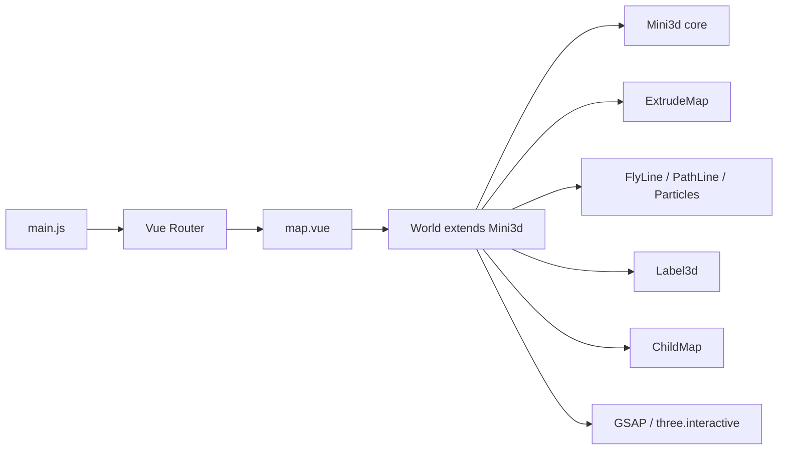
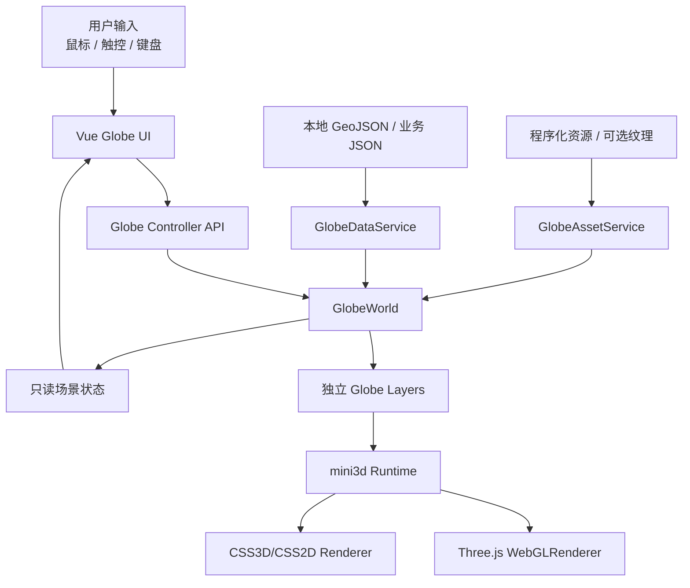
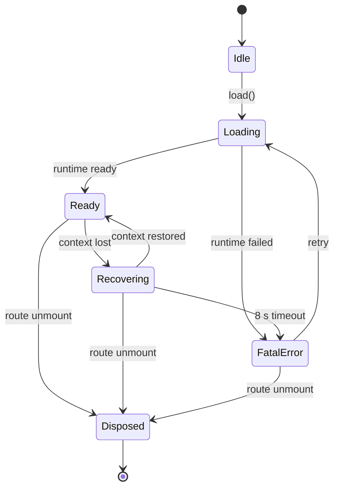
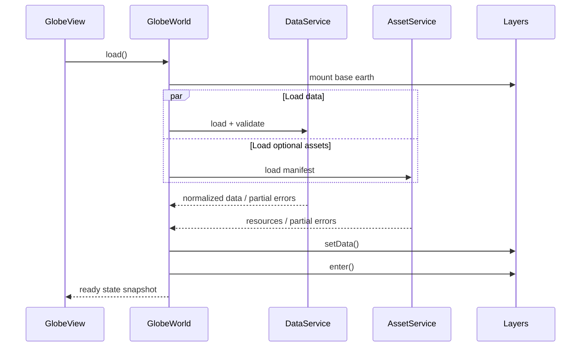

# 3D 地球技术架构设计

## 1. 架构结论

采用“参考并重构 mini3d 运行时思想 + 新建 globe 领域层 + Vue UI 控制层”的方案。中国地图与新地球保持两个独立项目，新项目不依赖参考工程的运行时入口或路由。

核心原则：

- 单一渲染循环；
- 单一球面坐标服务；
- 一图层一生命周期；
- UI 不直接操作 Mesh；
- 数据、配置、视觉和数学分离；
- 基础地球可在业务图层失败时独立运行。

### 1.1 M6 落地状态

- `GlobeWorld` 保持单一 RAF、渲染器和相机控制器；
- `createGlobeState` 管理初始只读状态结构；
- `createGlobeLayers` 负责基础层和数据层装配，具体几何仍由各 Layer 自己拥有；
- `GlobeDataService` 校验并解析节点/航线数据；
- `GlobeInteractionService` 独立处理拾取、点击/拖拽判定和 Esc；
- 中文标签采用手动投影的轻量 DOM overlay，没有引入第二个 CSS3D renderer；
- 当前未复制参考工程的 `mini3d` 源文件，复用的是生命周期、图层和效果 API 思路。
- M3 的陆运与海航共享 `RouteLayer`，只通过数据与样式配置区分；
- `ParticleHaloLayer` 使用单 Points geometry，由质量档控制粒子数量；
- `GlobeWorld` 通过 selectable layer 集合广播选中节点，避免随着图层数量增加继续堆积具体类型判断。
- `MarkerLayer` 使用三组可见 `InstancedMesh` 和一组实例化拾取体，将默认场景 draw calls 从约 118 降到 39；
- `mountGlobeLayers` 隔离构造/挂载失败，并把空数据归一为 `empty`；
- `GlobeContextRecovery` 独立管理 lost、restored 和 8 秒超时；
- `GlobeDiagnostics` 统一采样 FPS、renderer、GPU 资源和数据规模；
- 生产构建按 Vue、Three.js、GSAP、Geo 与业务页面拆包。
- `SeaRoutePlanner` 将 Natural Earth 陆地多边形转为通行掩膜，通过球面
  水域网格 A*、线段抽样和局部加密为海航生成避陆 waypoint；
- `AtmosphereLayer` 增加可独立关闭的扫描光幕和动态 Fresnel；
- `GlobeWorld.setTheme()` 向实现 `setTheme()` 的图层广播四套语义色；
- `RouteLayer` 以核心/柔光双 pass 区分陆运短脉冲与海运连续流光。
- `GlobeAssetService` 在创建 WebGL 图层前并行解码两张本地 4K 贴图，并把
  真实完成度推送给 Vue Loading；加载完成后才进入 `entering` 状态。
- `EarthLayer` 在同一 shader 中平滑混合程序化地表、白天和增强夜景纹理；
  模式切换不重建 Mesh、geometry 或材质。
- `GlobeInteractionService` 先拾取实例化节点，未命中时再拾取地球表面；
  球面交点反算经纬度后交由 `CountryService` 做 GeoJSON 包含判断。
- `BoundaryLayer` 使用三层 `LineSegments2`：12 px 呼吸柔光、3.2 px 实体
  轮廓、5.2 px dashOffset 流动亮段；取消聚焦时释放临时 geometry/material。
- `GlobeCameraController` 统一拥有约 4.1 秒入场和 1.55 秒国家聚焦镜头，
  `prefers-reduced-motion` 下跳过长入场。

## 2. 参考工程架构分析

本节描述 `../china-3d-map1`，不是新项目当前目录结构。

### 2.1 调用链



### 2.2 可复用优势

- `Mini3d` 已统一 scene、camera、renderer、Time、Sizes；
- `Resource` 有统一资源加载概念；
- `Label3d` 能把 CSS3DRenderer 与 WebGLRenderer 叠加；
- 飞线、路径、粒子已有基础实现；
- GSAP 已用于首屏时序和 hover/镜头动画；
- InteractionManager 已用于 Mesh 事件；
- 数据与部分视觉素材已独立文件化。

### 2.3 现有限制

- `map.js` 同时承担资源、场景、UI 状态、交互、动画和业务图层；
- 所有地理效果使用 d3 `geoMercator`，本质是平面；
- 地图组固定旋转到 XZ 平面，柱体统一沿局部 Z 轴；
- 飞线使用平面二次贝塞尔，路径使用平面 CatmullRom；
- 标签没有球背可见性、避让与批量性能策略；
- 图层按钮直接操作 `app.barGroup.visible` 等内部属性；
- 匿名 Time/resize 订阅难以单独解除；
- `Sizes.destroy()` 未移除 window resize listener；
- `Mini3d.destroy()` 对材质数组/纹理/非 Mesh 资源回收不完整；
- 异步 fetch 没有 AbortController、错误状态和超时；
- 存在未使用的 `baseMap.js`/`line.js` 等遗留文件，其中引用未声明的 `yuka`；
- 参考工程无测试、lint 和类型约束；
- 参考工程主场景 chunk 约 766.86 kB，不能直接整包复制到新项目。

## 3. 目标系统上下文



## 4. 分层设计

### 4.1 表现层

`GlobeView.vue` 和 `components/globe-ui`：

- 创建/销毁 `GlobeWorld`；
- 展示按钮、导航、tooltip、加载和错误；
- 将用户意图发送给 controller；
- 订阅只读状态；
- 处理响应式和无障碍。

不允许：

- `scene.getObjectByName()`；
- 直接设置 Mesh visible/material；
- 在模板内拼接 3D 对象；
- 保存 Three.js 对象进 Vue 深度响应式状态。

### 4.2 应用编排层

`GlobeWorld`：

- 初始化运行时；
- 注册图层；
- 管理状态机；
- 转发数据；
- 协调选中与关联高亮；
- 处理质量档；
- 统一更新与销毁。

公开 API 示例：

```js
world.load()
world.setLayerVisible("flightArcs", true)
world.focusLocation("guangzhou")
world.applyPreset("china")
world.setQuality("medium")
world.resetView()
world.dispose()
```

### 4.3 领域图层

| 图层 | 职责 | 主要技术 |
|---|---|---|
| EarthLayer | 球体本体、程序化地表 | SphereGeometry + Shader/StandardMaterial |
| AtmosphereLayer | Fresnel 辉光 | BackSide + additive shader |
| BoundaryLayer | 国界/海岸线 | GeoJSON → 球面 BufferGeometry |
| MarkerLayer | 标点、波纹与实例拾取 | 3×InstancedMesh + instanceId 映射 |
| BarLayer | 球面柱状图 | InstancedMesh 或合并几何 |
| FlightArcLayer | 一对多飞线 | Tube/Line2/自定义 shader |
| RouteLayer | 陆运/海航路径 | 手工或自动 waypoint → 球面双 pass 曲线 |
| LabelLayer | CSS 标签、可见性、避让 | CSS3D/CSS2D + 屏幕投影 |
| ParticleHaloLayer | 地球环绕粒子 | Points + shader |
| StarfieldLayer | 深空背景 | Points |

### 4.4 基础设施层

- `GlobeAssetService`：资源清单、加载、缓存、引用和释放；
- `GlobeDataService`：加载、校验、规范化、索引；
- `SeaRoutePlanner`：海陆分类、球面水域 A*、路线简化、复核与缓存；
- `GlobeInteractionService`：raycast、hover、selection、pointer capture；
- `GlobeQuality`：质量档与动态降级；
- `GlobeLifecycle`：事件、Observer、超时器和销毁注册；
- `GlobeContextRecovery`：WebGL 丢失、恢复与超时状态；
- `GlobeDiagnostics`：帧率、draw calls、三角面和资源计数。

## 5. 核心球面数学

### 5.1 经纬度转球面坐标

所有图层调用同一函数。约定：

- 输入 `[longitude, latitude]`；
- Y 轴向上；
- `radius` 为世界单位；
- `longitudeOffset` 控制默认正面方向。

```js
export function lonLatToVector3([lon, lat], radius, longitudeOffset = 0) {
  const phi = (90 - lat) * Math.PI / 180
  const theta = (lon + 180 + longitudeOffset) * Math.PI / 180

  return new Vector3(
    -radius * Math.sin(phi) * Math.cos(theta),
    radius * Math.cos(phi),
    radius * Math.sin(phi) * Math.sin(theta)
  )
}
```

最终正负号必须由测试固定，不允许各层自行“补 rotateY”。

### 5.2 球面朝向

点位法线：

```js
const normal = position.clone().normalize()
```

柱体/标记默认局部 Y 轴朝外：

```js
object.quaternion.setFromUnitVectors(
  new Vector3(0, 1, 0),
  normal
)
```

### 5.3 飞线曲线

推荐两种实现：

1. **球面插值 + 正弦抬升**

```text
surface(t) = slerp(normalizedStart, normalizedEnd, t)
height(t) = sin(πt) × arcHeight
point(t) = surface(t) × (R + height(t))
```

优点：接近大圆路径，抬升可控，端点稳定。

2. **三点 Catmull/Quadratic**

中点为两端法线和的归一化向量乘以 `R + arcHeight`。实现简单，但接近对跖点时必须提供辅助轴。

首版优先方案 1。

弧高建议：

```text
angle = acos(clamp(dot(startNormal, endNormal), -1, 1))
arcHeight = clamp(R × angle × factor, minHeight, maxHeight)
```

### 5.4 标签可见性

若相机在球外，标签法线与“标签到相机”方向点积大于阈值时可见：

```text
visible = dot(surfaceNormal, normalize(cameraPos - labelPos)) > horizonThreshold
```

再叠加：

- frustum 检测；
- 投影到屏幕后的边界检测；
- 工具栏排除区；
- 屏幕空间碰撞；
- priority 排序。

地平线阈值应留 0.02～0.08 的淡出带，避免旋转时跳闪。

### 5.5 日期变更线

纯两端球面插值天然可走最短弧。多控制点路径在预处理时需要：

- 经度归一；
- 检测相邻点经度差绝对值是否 >180°；
- 不对经度做普通线性插值；
- 每段独立做球面插值并合并。

## 6. 场景图

```text
Scene
├─ CameraRig
│  └─ PerspectiveCamera
├─ Lighting
├─ BackgroundGroup
│  ├─ StarfieldLayer
│  └─ FarParticles
├─ GlobeRoot
│  ├─ EarthLayer
│  ├─ BoundaryLayer
│  ├─ AtmosphereLayer
│  ├─ MarkerLayer
│  ├─ BarLayer
│  ├─ FlightArcLayer
│  ├─ LandRouteLayer
│  ├─ SeaRouteLayer
│  └─ ParticleHaloLayer
└─ OverlayAnchorGroup
   └─ Label anchors

DOM overlay
├─ CSS label renderer
└─ Vue UI
```

地球整体旋转和镜头环绕只选择一种主策略：

- 推荐 OrbitControls 环绕固定地球；
- 聚焦时计算目标方向并驱动相机 rig/controls；
- 不同时让 GlobeRoot 与 Camera 相互补偿旋转，避免拾取与标签错位。

## 7. 状态模型

### 7.1 场景状态

```js
{
  phase: "idle|loading|ready|recovering|fatal-error|disposed",
  quality: "low|medium|high",
  preset: "global|china|guangdong|custom",
  selectedLocationId: null,
  hoveredLocationId: null,
  autoRotate: true,
  layerIssues: [],
  layers: {
    bars: { visible: false, status: "idle|ready|empty|error", error: null },
    flightArcs: { visible: true, status: "ready", error: null },
    labels: { visible: true, status: "ready", error: null },
    landRoutes: { visible: true, status: "ready", error: null },
    seaRoutes: { visible: true, status: "ready", error: null },
    particleHalo: { visible: true, status: "ready", error: null }
  }
}
```

UI 只消费这个状态的序列化快照，不持有 Mesh。

### 7.2 生命周期状态机



任何异步回调在写状态前必须检查不是 `Disposed`。

## 8. 数据流



建议使用 `AbortController`，并在路由卸载时取消 fetch。

## 9. 渲染策略与权衡

### 9.1 无贴图地球

方案 A：`MeshStandardMaterial` + 灯光 + onBeforeCompile。

- 优点：开发快，可复用光照；
- 缺点：程序化效果受 Three 内部 shader 片段版本影响。

方案 B：完整 `ShaderMaterial`。

- 优点：表现与性能可控；
- 缺点：需要自行处理光照、色彩空间和维护。

首版建议 A；大气层使用独立 ShaderMaterial。若程序化扫描效果复杂，再迁移 EarthLayer。

### 9.2 边界线

方案 A：每个国家一个 `Line`。

- 易开发，但 draw calls 多。

方案 B：预处理并合并为少量 BufferGeometry。

- 性能更好，交互分国家较难。

首版边界只用于视觉，建议合并；国家交互通过点/数据索引，不依赖边界 Mesh。

### 9.3 飞线

方案 A：每条 TubeGeometry。

- 与旧代码接近、视觉稳定；
- 面数和 draw calls 高。

方案 B：Line2。

- 线宽稳定；
- 大量对象仍需要合并。

方案 C：单 BufferGeometry + 自定义 shader。

- 最佳批处理与流动尾部；
- 开发成本最高。

P0 可用少量 Tube/Line2；在 P1 线路超过 100 时升级 C。

### 9.4 标签

CSS3D 优点是清晰、样式方便，缺点是 DOM 重排、遮挡与深度不天然一致。首版限制默认标签数量并做球背隐藏。高密度需求转 SDF/Canvas 图集。

### 9.5 拾取

可继续使用 `three.interactive`，但地球新模块更适合统一 Raycaster：

- pointermove 只 raycast 注册的交互层；
- 节流到每帧最多一次；
- marker 使用实例化时维护 instanceId → dataId 映射；
- pointer down/up/cancel 使用 pointer capture；
- 标签 DOM 与 canvas 事件区分。

为了减少依赖耦合，新地球建议封装原生 Raycaster；旧地图继续保持 three.interactive。

## 10. 质量档

| 项目 | 低 | 中 | 高 |
|---|---:|---:|---:|
| pixel ratio | 1 | min(DPR, 1.5) | min(DPR, 2) |
| 球体分段 | 48×32 | 64×48 | 96×64 |
| 星点 | 500 | 1100 | 1800 |
| 光环粒子 | 420 | 900 | 1500 |
| 默认标签 | 10 | 25 | 40 |
| 飞线细分 | 32 | 64 | 96 |
| Bloom | 无 | 无 | 后续可选 |

可用启动探测选择默认档，也允许用户手动切换。动态降级应有滞后，避免档位抖动。

## 11. 资源与构建

- 根路径默认加载地球；若后续增加其他页面，地球路由使用动态 import；
- 新项目不得从 `../china-3d-map1/src` 做跨项目源码 import；复用代码必须复制到本项目、注明来源并完成适配；
- Three.js、Vue、GSAP 和 Geo 依赖已使用 Rolldown 分组拆包，最大 chunk 约 474.41 kB，gzip 约 118.99 kB；
- 世界 GeoJSON 可离线简化，保留适合屏幕尺度的精度；
- 使用 Vite `BASE_URL` 组装 public 路径；
- 新项目默认 Vite base 为 `/`；生产部署前按目标子路径单独配置，不复制参考工程的 `"/sayhello-site/"`；
- 建议为 GeoJSON 增加版本/哈希和 gzip/brotli；
- 图片素材必须纳入 manifest 并记录许可；
- 首版程序化纹理用 CanvasTexture 时同样需要 dispose。

## 12. 生命周期治理

建议提供 `DisposerRegistry`：

```js
const disposer = new DisposerRegistry()
disposer.addEvent(target, "resize", handler)
disposer.addSubscription(time, "tick", update)
disposer.addTween(tween)
disposer.addThreeObject(group)
disposer.addAbortController(controller)
disposer.disposeAll()
```

重点修复：

- Sizes 保存并移除 resize handler；
- Time 订阅返回 unsubscribe；
- GSAP 用 context 或集中 kill；
- Interaction/Raycaster 注册表清空；
- CSS3DRenderer DOM 移除；
- render target、geometry、material、texture 释放；
- 共享 material 不被某一 layer 提前释放。

## 13. 测试架构

### 13.1 单元测试

- `lonLatToVector3`：
  - 北极、南极、赤道四象限；
  - 输出长度等于 radius；
  - 输入不被修改。
- `buildGreatCircleArc`：
  - 端点一致；
  - 中点半径大于球半径；
  - 跨 180°；
  - 近对跖点；
  - 相同端点。
- `isLabelVisible`：
  - 正面、背面、地平线、视锥外。
- 数据 schema：
  - 缺 id、非法经纬度、重复 id、缺 route endpoint。

### 13.2 集成测试

- 图层开关多次执行对象计数不增长；
- 加载部分失败；
- 聚焦动画中切换目标；
- route unmount 取消请求和 RAF；
- WebGL context lost；
- quality 切换重建需要重建的层。

### 13.3 E2E/视觉

- 首屏截图；
- 全图层开/关；
- 三个视角预设；
- 城市选中；
- 1366×768、1920×1080、390×844；
- reduced motion；
- 模拟慢网和 404。

## 14. 风险、影响与缓解

| 风险 | 概率 | 影响 | 缓解 |
|---|---:|---:|---|
| 静态参考图无法确认真实交互 | 高 | 中 | 假设配置化，先做 MVP 评审 |
| 世界 GeoJSON 体积/许可不明 | 中 | 高 | 选公开数据、记录许可、离线简化 |
| CSS3D 标签穿透/重叠 | 高 | 中 | 半球裁剪、优先级、数量上限 |
| 大量 TubeGeometry 掉帧 | 中 | 高 | P0 限量，P1 合批 shader |
| 复制 mini3d 时带入生命周期泄漏 | 高 | 高 | 选择性复制，新层强制 dispose，复制前先修基础接口 |
| onBeforeCompile 随 Three 版本脆弱 | 中 | 中 | 锁版本、shader 测试、隔离封装 |
| 低端移动 GPU 过热 | 中 | 高 | 质量档、暂停后台、关闭高成本层 |
| 视觉依赖 Bloom 才好看 | 中 | 中 | 先用材质层次验收，再决定后处理 |
| 参考素材版权 | 中 | 高 | 不抓取未知素材，记录来源 |
| 部署子路径配置错误 | 中 | 高 | 发布前按独立项目环境验证 Vite base |
| 真实数据含义未定义 | 高 | 中 | 明确演示数据标识，schema 先行 |

## 15. 架构决策记录

### ADR-001 新旧项目分离

- 决策：地球使用独立 `globe-3d-map` 项目，中国地图保留在 `../china-3d-map1`。
- 原因：隔离依赖、构建、路由和回归风险。
- 代价：通用运行时和素材需要选择性复制，后续升级可能需要同步维护。

### ADR-002 首版无贴图

- 决策：程序化球体 + GeoJSON 边界。
- 原因：满足当前素材约束并先验证几何/交互。
- 代价：照片真实感低于参考图。

### ADR-003 单一球面坐标服务

- 决策：所有点、线、柱、标签统一依赖 `globe/math/geo.js`。
- 原因：避免方向、半径和偏移不一致。
- 代价：参考工程的平面组件需适配或重写后才能放入新项目。

### ADR-004 不新增通用 UI 库

- 决策：使用项目内轻量 Vue 组件。
- 原因：控件少，减少包体与视觉覆盖成本。
- 代价：可访问性和状态组件需自行实现。

### ADR-005 P0 限量，P1 合批

- 决策：先以少量几何验证，再按实测升级批处理。
- 原因：避免在需求未确认前投入复杂 shader 管线。
- 代价：P0 不适合超大数据量。
