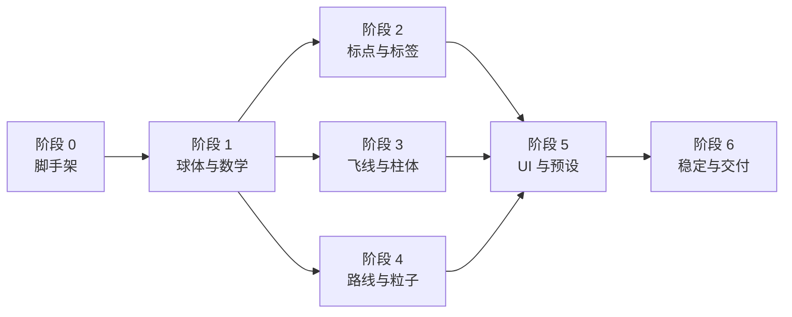

# 3D 地球开发排期计划

## 当前执行状态

- M1 基础地球 MVP：已于 2026-07-26 完成；
- M2 核心数据图层：已于 2026-07-26 完成，覆盖原计划阶段 2 和阶段 3；
- M3 运输路径与粒子光环：已于 2026-07-26 完成，覆盖原计划阶段 4；
- M4 稳定、性能与交付：已于 2026-07-26 完成，覆盖原计划阶段 5 和阶段 6；
- M5 海路与视觉升级：已于 2026-07-26 完成，包含海运绕陆、动态辉光、
  多主题和运输线材质升级；
- M6 交互与地表升级：已于 2026-07-27 完成，包含资源 Loading、长入场、
  国家聚焦多层流光和本地 4K 昼夜贴图三态切换；
- 详细实现和验收记录见 `05-m1-implementation.md` 至
  `10-m6-loading-focus-textures.md`。

## 1. 估算口径

- 基线：1 名前端开发全职投入，已有 Three.js 基础；
- 工期：16 个开发日 + 4 个工作日风险缓冲，共 4 周；
- 设计、产品和数据方能在阶段验收日及时反馈；
- 首版使用本地演示数据，不等待后端接口；
- 新项目首版保持 JavaScript，不包含 TypeScript 迁移；
- P0 与 P1 交付范围以 `01-requirements.md` 为准。

如果由不熟悉 Three.js 的开发者执行，建议增加 30%～50% 工期。

## 2. 总体里程碑

| 周次 | 里程碑 | 主要结果 |
|---|---|---|
| 第 1 周 | M1 基础地球 MVP | 地球入口、程序化球体、大气、星空、控制器、数学测试 |
| 第 2 周 | M2 核心数据图层 | 标点、标签、飞线、柱状图、演示数据 |
| 第 3 周 | M3 完整交互与运输图层 | 陆运、海航、粒子光环、工具栏、视角预设 |
| 第 4 周 | M4 稳定与交付 | 错误/降级、性能、响应式、泄漏检查、文档与验收 |
| 增量阶段 | M5 路径与视觉升级 | 海陆掩膜、海运 A*、辉光动画、多主题、路线双 pass |

## 3. 详细排期

### 阶段 0：基线锁定与脚手架（1.5 人日）

任务：

- 确认新项目根入口与可选 `/three-3d-globe` 路由策略；
- 新建 `views/globe`、`globe`、`components/globe-ui`、`styles`；
- 抽取/新增设计 token；
- 新建 GlobeWorld、layer 接口和 dispose 注册表；
- 增加最小测试框架；
- 记录新项目官方模板构建基线，并保留参考工程效果截图；
- 清点世界 GeoJSON 来源和许可。

交付：

- 空地球页能进入/退出；
- 新项目模板构建成功，参考工程未被修改；
- `npm run build` 通过；
- 测试脚本可运行。

退出条件：

- 路由、目录、接口命名确定；
- 世界边界数据方案明确；
- P0 默认图层得到确认或采用文档默认值。

### 阶段 1：球体与相机 MVP（2.5 人日）

任务：

- 实现 `lonLatToVector3`、法线对齐、大圆插值；
- 实现 EarthLayer；
- 实现 AtmosphereLayer；
- 实现 StarfieldLayer；
- 增加国界/海岸线球面转换；
- 配置 OrbitControls；
- 实现默认亚洲视角与自动旋转暂停；
- 添加球面数学单测。

交付：

- 无贴图地球可旋转、缩放；
- 亚洲默认面向镜头；
- 地球、大气、边界与星空完成；
- 北极/赤道/跨日期变更线测试通过。

退出条件：

- 无接缝、无明显 z-fighting；
- 相机不会进入球体；
- 页面销毁后无额外 RAF/canvas。

### 阶段 2：标点、标签与聚焦（2.5 人日）

任务：

- 定义并校验 location schema；
- 实现 MarkerLayer；
- 实现广州主枢纽、普通城市与波纹；
- 实现 LabelLayer；
- 增加球背隐藏、地平线淡出、基础避让；
- 实现 Raycaster hover/select；
- 实现城市聚焦、退出聚焦；
- 移动端点击替代 hover。

交付：

- 默认城市与广州高亮；
- 标签不穿透球体；
- 点击城市可聚焦；
- tooltip 能显示演示信息。

退出条件：

- 快速选中不同城市状态正确；
- 标签数量和 DOM 更新在预算内；
- 工具栏区域不被标签覆盖。

### 阶段 3：飞线与柱状图（3 人日）

任务：

- 定义 route schema；
- 实现球面 FlightArcLayer；
- 实现亮头/渐隐尾；
- 实现广州一对多示例；
- 实现 BarLayer；
- 实现球面法线对齐、值域归一和 Top N 高亮；
- 增加飞线/柱图显隐动画；
- 增加相同端点、近对跖点和全零数据测试。

交付：

- 青色普通飞线、黄色重点飞线；
- 柱体沿球面法线增长；
- 球体正确遮挡背面线和柱；
- 图层快速开关幂等。

退出条件：

- 默认数据量下 FPS 达阶段目标；
- 不出现 NaN geometry；
- 关闭图层后停止更新。

### 阶段 4：陆运、海航与粒子光环（2.5 人日）

任务：

- 实现多 waypoint RouteLayer；
- 区分陆运与海航样式；
- 实现 ParticleHaloLayer；
- 低质量档减少粒子和细分；
- 增加演示数据标识；
- 增加空数据/错误状态。

交付：

- 三种线类可同时辨识；
- 粒子环有正确前后深度；
- 各图层独立切换；
- 无数据时按钮有明确信息。

退出条件：

- 视觉密度符合 design.md；
- 粒子关闭时不更新；
- 日期变更线路径正确。

### 阶段 5：UI、预设与响应式（1.5 人日）

任务：

- 完成 EffectToolbar；
- 完成 GlobeBreadcrumb/视角预设；
- 完成 Loading、Error、Tooltip；
- 实现 active/disabled/loading/error；
- 键盘与焦点；
- 1366×768、1920×1080、390×844 布局；
- `prefers-reduced-motion`。

交付：

- 左侧工具栏和底部预设匹配设计方向；
- 移动端工具栏改为底部；
- 三个预设稳定切换；
- 键盘和降低动效可用。

退出条件：

- UI 状态与场景状态一致；
- 连续操作不产生动画竞争；
- 核心内容不被遮挡。

### 阶段 6：稳定、性能与交付（2.5 人日）

任务：

- 局部/致命错误与重试；
- AbortController；
- context lost/restore；
- 页面隐藏降频；
- 高/中/低质量档；
- draw calls、FPS、triangles、heap 记录；
- 路由往返 10 次泄漏检查；
- 构建拆包与 GeoJSON 压缩；
- 确认参考工程目录无非预期修改；
- 更新 README、文档与素材许可。

交付：

- 可发布候选版本；
- 性能报告；
- 测试/视觉截图；
- 已知问题列表；
- 完整开发交接。

退出条件：

- 总体验收清单通过；
- 无 P0 阻断问题；
- 性能与兼容性风险有记录；
- 构建和部署路径验证完成。

## 4. 任务依赖

单人开发按顺序执行。多人开发时，阶段 2、3、4 可在阶段 1 接口冻结后并行，但必须由同一球面数学和 layer 接口约束。

## 5. 每周验收

### 第 1 周评审

- 无贴图球体视觉是否可接受；
- 亚洲默认视角是否正确；
- 大气强度、背景密度、基本色板是否定稿；
- 世界边界数据许可是否确认。

若球体视觉未通过，不进入大量业务图层开发，先调整材质方向。

### 第 2 周评审

- 广州枢纽是否突出；
- 标签密度与聚焦交互是否符合演示；
- 飞线颜色、弧高、速度是否合适；
- 柱状图是否本期默认开启。

### 第 3 周评审

- 陆运/海航语义是否清楚；
- 工具栏与视角预设是否符合实际产品含义；
- 移动端是否保留在本期；
- 是否需要贴图进入 P2。

### 第 4 周验收

- 功能、视觉、性能、边界、销毁、兼容性；
- 相邻中国地图项目未被修改；
- 许可与部署配置；
- 剩余问题按 P0/P1/P2 分级。

## 6. 风险缓冲

预留 4 个工作日，不提前绑定具体任务：

| 风险 | 建议缓冲 |
|---|---:|
| 世界边界清洗/简化和许可替换 | 1 日 |
| 标签遮挡与移动端适配 | 1 日 |
| 飞线批处理或 shader 调整 | 1 日 |
| 生命周期泄漏、部署路径与兼容问题 | 1 日 |

缓冲不用于临时扩大范围。若没有触发风险，用于性能和测试增强。

## 7. 优先级与裁剪顺序

若必须压缩工期，按以下顺序裁剪：

1. 延后高质量档和自动动态降级；
2. 延后复杂标签避让，仅保留优先级 + 球背隐藏；
3. 延后海航/陆运中的一种；
4. 降低粒子光环复杂度；
5. 延后移动端精细适配；
6. 延后 Bloom 和所有贴图。

不可裁剪：

- 统一球面数学；
- 独立图层生命周期；
- 基础错误处理；
- 独立项目边界检查；
- 构建通过；
- 经纬度、跨日期变更线和球背标签测试。

## 8. 缺陷分级

- P0 阻断：
  - 页面白屏、构建失败；
  - 地球不可交互；
  - 主要图层无法显示；
  - 路由切换持续泄漏；
  - 未授权素材；
  - 关键坐标算法错误。
- P1 高：
  - 标签大面积透背/重叠；
  - 图层状态与 UI 不一致；
  - 默认设备低于性能下限；
  - 错误或空数据导致整页不可用。
- P2 中：
  - 个别动效节奏、细微对齐；
  - 极端宽高比布局；
  - 非主流浏览器表现差异。
- P3 低：
  - 非核心装饰差异；
  - 开发模式日志或工具优化。

## 9. 每日完成检查

- [ ] 代码属于正确模块；
- [ ] 未复制球面公式；
- [ ] 新监听/订阅/动画有 dispose；
- [ ] 新色值/尺寸进入 token/config；
- [ ] 图层开关可重复执行；
- [ ] 错误和空数据有行为；
- [ ] 新逻辑有相应测试；
- [ ] `npm run build` 通过；
- [ ] 未修改相邻中国地图项目；
- [ ] 文档或数据 schema 已同步。

## 10. 交付物

- 新 3D 地球页面与路由；
- 本地演示数据；
- 世界边界数据及许可证记录；
- 单元/集成/E2E 测试；
- 三类分辨率视觉截图；
- 性能基线报告；
- 构建产物验证；
- 更新后的 AGENTS、design、需求、架构和排期文档；
- 已知问题与后续 P2 清单。
